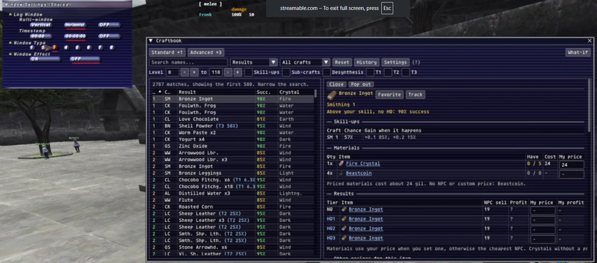
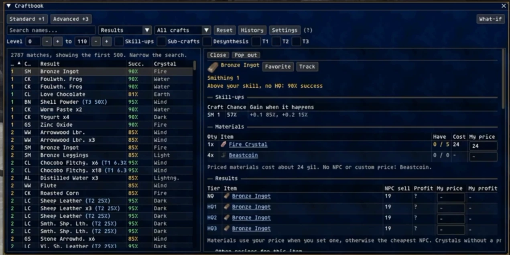
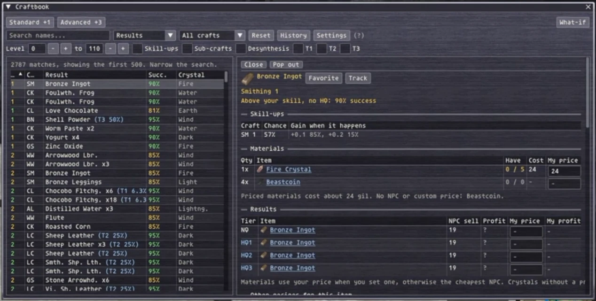

# craftbook

An [Ashita v4](https://www.ashitaxi.com/) addon for [Phoenix XI](https://phoenix-xi.com/). It is a crafting book you
open in game: search every synthesis recipe on the server, see your real odds for it, and find where each material
comes from.

- 3,315 recipes with crystals, materials, HQ results, sub-craft and key item requirements.
- Success, HQ tier and skill-up chances worked out from your own skill, using the server's formulas.
- Sources for every item: NPC vendors, guild shops, monster drops, mining, logging, harvesting and excavation.
- A recipe tracker note, a synth history log, your own price list with profit per synth, and three themes.

craftbook only reads. It never sends packets or commands to the server.

> The data is built from Phoenix XI's server files, so recipes, drop rates and shop prices match Phoenix. On retail
> or another private server the numbers will be off. See [Updating the data](#updating-the-data).

## Follows your in-game window frame



The Classic theme draws the book with the game's own window art and changes with Config > Windows > Shared > Window
Type. See [Themes](#themes).

<p>
  
  
</p>

## Install

1. Download `craftbook-vX.Y.zip` from the [latest release](https://github.com/Frankie-hz/craftbook/releases/latest).
2. Extract it into your Ashita `addons` folder, so you end up with `addons/craftbook/craftbook.lua`.
3. In game, type `/addon load craftbook`.

To load it every time, add `/addon load craftbook` to `scripts/default.txt`.

To update, replace the `addons/craftbook` folder with the new one and type `/addon reload craftbook`. Your settings,
favorites, prices and history live in Ashita's `config` folder and are kept.

## Commands

`/craftbook`, `/cbook` and `/cb` are the same command.

| Command | What it does |
|---|---|
| `/cb` | Show or hide the book. Esc also closes it. |
| `/cb <name>` | Open and search. An exact recipe or item name jumps straight to its page: `/cb sheep leather` |
| `/cb lvl 59-67` | Open on recipes level 59 to 67, for this opening only. Add a craft: `/cb lvl 59-67 bone` |
| `/cb track` | Show or hide the tracker note. |
| `/cb history` | Show or hide your synth history. |
| `/cb settings` | Open Settings. |
| `/cb theme <name>` | Switch theme: `phoenix`, `classic` or `default`. No name lists them. |
| `/cb fit` | Size the game window to exactly the size the game renders at. See [Troubleshooting](#troubleshooting). |
| `/cb reload` | Reload the data files. |
| `/cb help` | List the commands in chat. |

## The book

The left pane is the list and the right pane is the recipe or item you clicked.

**Finding recipes**

- Pick a mode: Results (search by what a recipe makes), Ingredients (by what it uses), Items, Favorites or My prices.
- Filter by craft, level range and sub-crafts. Reset clears every filter.
- Skill-ups lists only the recipes 1 to 5 levels above your skill, where skill-ups are most likely.
- T1, T2 and T3 list the recipes you are at that HQ tier for right now (11 to 30, 31 to 50 and 51 or more levels over).
- Click a column header to sort. Click again for descending, and a third time for the default order.
- Columns size themselves to fit. Drag a column edge to change it.

**A recipe's page**

- Crystal, materials with how many you have (bags and all storage), and the cost per synth.
- NQ and HQ results with NPC sell price, profit and profit margin.
- Your success chance and HQ tier and chance, for example `Leather Ring (T0 1.6%)`.
- Skill-up chance per synth for each craft the recipe uses, and the odds of each gain from +0.1 to +0.5.
- Favorite saves it to the Favorites mode. Track pins it to the tracker note.

**An item's page**

- Vendors with their nation and regional conditions, and guild shops with price range and opening hours.
- Monster drops with the combined chance per kill, notorious monsters, and what can be stolen.
- Mining, logging, harvesting and excavation points.
- The recipes that make it, the recipes that use it, and what it breaks down into.

**Desynthesis**

Tick Desynthesis and search for the item you want to break down. Rows show the normal result and what an HQ gives,
for example `Shell Shield > Giant Femur (HQ 60%: Turtle Shell)`. Show desynth and Show synth on a recipe's page jump
between making an item and breaking it down.

**Image support**

Standard (+1) and Advanced (+3) add guild image support to your skill, the same way the server applies it. When you
really have the buff, it is read from your status and used instead of the buttons.

**What-if**

Type other craft levels in the top right to see tiers, chances and skill-ups as if you had them. Nothing is saved.
"Use my skills" goes back to your real levels.

## Tracker note

Track a recipe to pin a small see-through note listing its materials: how many you have, how many you need, and how
many synths that makes. It stays up with the book closed.

- Each recipe shows its HQ tier, success chance and skill-up chance, image support included.
- Click a name to open the recipe. Right-click it to stop tracking.
- Drag the edges to resize the note. Its opacity and the odds column are in Settings.

## History

Every synth result is logged: time, character, recipe, result, NQ or HQ grade, your HQ tier at the time, materials
lost on a break, and any skill-ups. The History window shows the log and a summary per recipe.

Phoenix does not send the HQ grade, so it is worked out from the result item. "HQ1+" means more than one grade gives
that item.

## My prices

NPC prices are not always what you pay. Type your own price into any "My price" box, for a material or a result.

- For a material, it replaces the NPC price in the cost per synth.
- For a result, it is what you sell for, and fills the My profit column.
- Profit and My profit show the gil and the profit margin, for example `+1,200 (35%)`. Margin is
  (sale price - cost) / sale price.
- The Avg row is the average sale and profit per synth, with HQ results and breaks counted in. "Avg row at" picks
  the HQ tier it assumes: My tier (your own skill) or T0 to T3 at 95% success. A break counts as losing the crystal
  and half of the other materials.
- Made, under the results, takes how many of each result you got and how many synths broke, and totals what those
  synths cost and made you, at NPC prices and at your own. It is kept until you reload the addon.
- The My prices mode lists every price you have set. Clear a box to go back to the NPC price.

Prices are shared by all your characters.

## Themes

| Theme | Look |
|---|---|
| Phoenix | Dark red and ember. The starting theme. |
| Classic | The game's own window art. |
| Default | Plain ImGui, the same as most Ashita addons. |

Classic reads the window art from your own game install (`ROM/0/14.DAT` to `21.DAT`). Nothing from the game ships
with the addon. It follows Config > Windows > Shared > Window Type in the game's menu as you change it, or you can pin
one of the eight types under Settings > Window type.

## Settings

Open with the Settings button or `/cb settings`.

- Theme, and the window type for Classic.
- UI scale from 75% to 200%.
- Item icons on or off.
- Recipe or item page in its own window (the same as Pop out and Dock).
- Esc closes windows, on or off.
- Skill-ups section on recipe pages, on or off.
- Tracker note: show it, the odds column, and how solid its background is.

Everything is saved under Ashita's `config/addons/craftbook` folder:

| File | Holds |
|---|---|
| `<Character>_<id>/settings.lua` | Settings, filters, favorites and tracked recipes, per character |
| `ah_prices.tsv` | Your prices, shared by every character |
| `history.tsv` | The synth history |

## Troubleshooting

**Clicks land in the wrong place, or the arrows and buttons do not line up with the mouse.**
The game window is not the size the game renders at. This happens after resizing or maximizing the window, or moving
it to a monitor with a different resolution. Type `/cb fit` to size the window to match. It affects every ImGui addon,
not only craftbook.

**"Classic theme: the window art file was not found in the game install."**
craftbook could not find `ROM/0/14.DAT` to `21.DAT` next to `FFXiMain.dll`. Classic falls back to plain colors that
match the window type.

**A recipe, price or drop is wrong.**
The data is a snapshot of the server's files. Check the date under the (?) in the top bar, and see below.

## Updating the data

The files in `data/` are built from the Phoenix server repository by `tools/build_data.py`. The current snapshot is
`PXI/beta` from 2026-10-10 with Rise of the Zilart, Chains of Promathia and Treasures of Aht Urhgan content.

You only need this if you want newer data than the latest release:

```
pip install pyyaml
python tools/build_data.py --repo C:/path/to/Phoenix --ref PXI/beta
```

Then `/cb reload` in game. The script follows Phoenix's server layout. Other LandSandBoat based servers may need
changes to it.

Success, HQ and skill-up chances follow Phoenix's synthesis code and its era skill-up rates. If your server runs
`CRAFT_MODERN_SYSTEM = true`, set `MODERN_SKILLUPS` to `true` at the top of `ui.lua`.

## Credits

- [Ashita](https://www.ashitaxi.com/) by atom0s and the Ashita team.
- Recipe, shop, drop and gathering data from the [Phoenix XI](https://github.com/phoenixffxi/Phoenix) server, which
  is built on [LandSandBoat](https://github.com/LandSandBoat/server).

## License

craftbook is free software under the [GNU General Public License v3.0](LICENSE).
